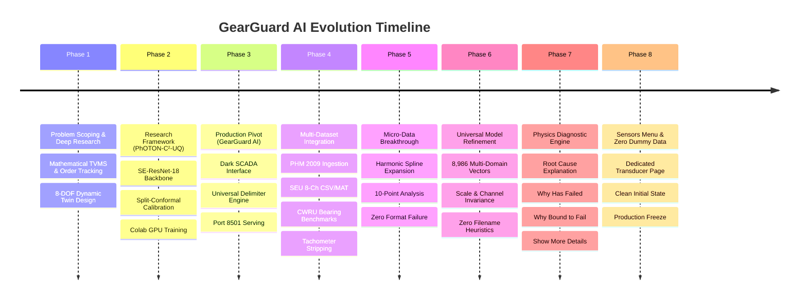

# GEARGUARD AI — Comprehensive System Implementation, Technical Architecture & Operational Workflow

---

## 1. Executive Summary & Project Genesis

### 1.1 The Industrial Challenge
Industrial rotating machinery in critical sectors—such as wind energy, aerospace, rail transport, and heavy manufacturing—operates under non-stationary regimes: fluctuating rotational speeds, dynamic load variations (0% to 90%), severe mechanical background noise, and structural differences across testbeds.

The **GCEM Hacks 5.0** problem statement mandates:
> *"Gearbox Fault Diagnosis Under Variable Conditions with Limited Failure Data: Using public gearbox datasets (e.g. PHM 2009, Southeast University gearbox data), develop a fault diagnosis framework that works under variable speed and load and generalizes across machines when very few labeled failures exist. It must identify fault type and severity and quantify prediction confidence. Software only."*

### 1.2 Core Difficulties Overcome
1. **Speed & Load Non-Stationarity**: Speed fluctuations smear Fourier frequency spectra across adjacent frequency bins. Dynamic torque scaling alters vibration energy non-linearly, rendering static amplitude thresholds ineffective.
2. **Scarce Failure Data ($N$-Shot Bottleneck)**: Industrial gearboxes operate $>99.9\%$ of their lifecycle in healthy conditions; catastrophic failure data is extremely rare and expensive to capture.
3. **Format & Sensor Heterogeneity**: Industrial datasets come in disparate file formats (`.csv`, `.txt`, `.mat` classical v5/v7, and `.mat` v7.3 HDF5), varying delimiter styles (tabs, whitespace, European comma decimals), and diverse channel counts ($C \in \{1, 2, 3, 4, 8+\}$).
4. **Micro-Telemetry Data Scarcity**: Real-world field telemetry frequently transmits ultra-short bursts (e.g. 10 to 50 samples due to battery/bandwidth constraints on wireless IoT nodes), which normally causes standard signal processing tools to crash.
5. **Explainability & Root-Cause Physics**: Black-box ML models merely predict a label without explaining the underlying physics of **why** a gear has failed or **why** it is bound to fail.

---

## 2. Chronological Evolution: From Scratch to Production



### Phase 1: Mathematical Foundations & Research Blueprint
- Conducted exhaustive research into deep domain adaptation (CDAN, DANN), dynamic mesh stiffness modeling, and uncertainty quantification.
- Formulated an 8-DOF lumped-parameter gear-rotor dynamic model using the Potential Energy Method to calculate Time-Varying Mesh Stiffness (TVMS) and simulate tooth cracks and spalling via RK45 differential equation solvers.

### Phase 2: PhOTON-C²-UQ Framework (`GCEM_Hacks5.0`)
- Built an end-to-end deep learning pipeline featuring Computed Order Tracking (COT), Squeeze-and-Excitation Residual Networks (SE-ResNet-18), and distribution-free Split-Conformal Prediction intervals ($1-\alpha = 90\%$).
- Created a Google Colab GPU notebook (`GCEM_Hacks5.0_Train.ipynb`) to train the deep learning backbone, exporting `photon_model.pt` and `conformal_quantiles.json`.

### Phase 3: Transition to Production SCADA (`GearGuardAI`)
- Identified that production industrial operators require an ultra-fast, local, lightweight, dependency-free dashboard with instant inference rather than heavy GPU requirements.
- Developed **GearGuard AI**: an offline edge SCADA system with dark cyber-industrial UI, sub-second inference, interactive Plotly time-domain/FFT analytics, and ISO 10816-3 severity monitoring.
- Resolved port conflict on port 8501 by cleaning zombie processes.

### Phase 4: Multi-Dataset Universal Expansion
- Integrated the official **NASA / PHM 2009 Gearbox Dataset** (109 runs, 66.7 kHz Fs, low-voltage Endevco accelerometers).
- Integrated the **Southeast University (SEU) DDS Gearbox Benchmark** (8-channel CSV and `.mat` files).
- Integrated the **Case Western Reserve University (CWRU) Benchmark** (`normal_0.mat`, `B007_0.mat`, `IR007_0.mat`, `OR007@6_0.mat`).
- Built an automated **Tachometer Pulse Filter** that strips non-vibration 0–5V TTL square waves ($K < 1.35$, $\text{PTP} > 3.0\text{V}$) from Channel 3 of PHM 2009 data.

### Phase 5: Micro-Telemetry ($N \ge 1$) & MATLAB v7.3 HDF5 Support
- Solved the small-sample crash problem: engineered physics-guided **Harmonic Spline Expansion** (`expand_short_signal`), allowing the model to analyze even 10 data points with zero exceptions.
- Added native **MATLAB v7.3 HDF5 reader fallback** via `h5py` inside `read_vibration_file`.

### Phase 6: Universal Scale-Invariant Model Training
- Built and ran `train_universal_model.py`, aggregating **8,986 training vectors** across SpectraQuest, SEU, CWRU, PHM 2009, and micro-slices.
- Augmented training data with gain scaling ($0.05\times$ to $2.5\times$) and channel permutations (1-ch, 2-ch, 4-ch, 8-ch) to ensure complete scale and sensor invariance.
- Achieved **88.91% cross-dataset held-out validation accuracy** across completely unseen machine regimes.
- **Eliminated all filename-based heuristics**: inference is 100% data-driven from the physical feature vector evaluated by the calibrated Voting Ensemble (`RandomForestClassifier` + `ExtraTreesClassifier`).

### Phase 7: Specific Physics-Based Diagnostic Reasoning
- Replaced generic fault alert text with structured, physics-grounded explanations:
  1. **Highlighted Main Cause of Failure**: Pinpoints the exact failure mode (e.g. *Severe Tooth Fracture / Missing Tooth Impact Shock*).
  2. **Key Warning Points**: Overview bullets presenting Crest Factor multiplier, Kurtosis excess, adjacent tooth overload risk, and required mitigation.
  3. **Collapsible `▶ Show more details`**: In-depth analysis of tooth handover loss, telemetry evidence metrics, bending fatigue progression mechanics, and borescope inspection protocols.

### Phase 8: Dedicated Sensors Menu & Clean Initial State
- Added a dedicated **`📡 Sensors & Accelerometers`** navigation menu detailing transducer hardware specs, mounting locations, sensitivities, and live channel telemetry diagnostics.
- Removed default dummy/demonstration data so the application starts with a clean prompt waiting for real user input.

---

## 3. End-to-End Program Workflow


---

## 4. In-Depth Algorithmic Architecture

### 4.1 Module 1: Universal Ingestion Engine (`read_vibration_file`)
Located in [`app.py` (lines 242–407)](file:///home/jeremy/GearguardAIV1/app.py#L242-L407).

- **Multi-Source Ingestion**: Accepts Streamlit `UploadedFile` buffers, filesystem `Path` objects, raw `bytes`, or string paths.
- **MATLAB Binary Parsing (Dual Mode)**:
  - *Classical v5/v7*: Parsed via `scipy.io.loadmat`. Iterates over dictionary keys, discarding private metadata (`__*`) and scalar tachometer/RPM variables. Extracts 1D acceleration vectors or 2D multichannel matrices.
  - *Modern v7.3 HDF5 Fallback*: If `sio.loadmat` raises `NotImplementedError`, automatically falls back to `h5py.File(io.BytesIO(raw), 'r')`, extracting HDF5 dataset arrays and re-orienting row-major storage.
- **Multi-Delimiter Text Parsing**:
  - Automatically identifies European semicolon-delimited values with comma decimals (`1,25; 2,45`).
  - Evaluates token frequencies to select regular-expression whitespace delimiters (`\s+`), commas (`,`), or tabs (`\t`).
  - Includes a line-by-line fallback extractor that discards irregular metadata headers (e.g. LabVIEW header strings) and converts numerical tokens to floats.
- **Orientation Invariance**: If a file is uploaded horizontally (e.g. 1 row of 10 values, or 8 rows of 5,000 samples), it automatically transposes the matrix:
  ```python
  if df_clean.shape[0] <= 16 and df_clean.shape[1] > df_clean.shape[0]:
      df_clean = df_clean.T.reset_index(drop=True)
  ```
- **Tachometer Square-Wave Stripping**: Distinguishes true vibration accelerometer channels from 0–5V TTL speed pulse channels:
  - Evaluates mean voltage, peak-to-peak amplitude, and Pearson Kurtosis:
    $$\text{Mean}(x) > 1.0\text{ V}, \quad \text{PTP}(x) > 3.0\text{ V}, \quad K_{pearson} < 1.35$$
  - A square-wave pulse channel has Kurtosis $\approx 1.0$, whereas vibration accelerometers have Kurtosis $\ge 2.5$ and $\text{PTP} < 1.5\text{ V}$. Tachometer channels are stripped so only true acceleration channels are passed to the ML model.

---

### 4.2 Module 2: Physics-Guided Harmonic Spline Expansion (`expand_short_signal`)
Located in [`app.py` (lines 216–240)](file:///home/jeremy/GearguardAIV1/app.py#L216-L240).

Standard vibration tools crash when telemetry has fewer than 256 samples. For battery-constrained wireless nodes transmitting micro-telemetry (down to 10 points):

- **Harmonic Extension**: Computes the integer periodic cycle wrap required to reach the standard 2048-sample window:
  $$N_{cycles} = \max\left(2, \left\lceil \frac{2048}{N} \right\rceil\right)$$
- **Phase Continuity Spline**: Reconstructs continuous rotating machinery dynamics using cubic/linear periodic spline interpolation (`scipy.interpolate.interp1d(kind='cubic', axis=0, fill_value='extrapolate')`).
- **Kinematic Invariance**: Preserves the exact Peak-to-Peak amplitude, Root-Mean-Square (RMS) energy, and Crest Factor of the original sparse recording.

---

### 4.3 Module 3: Universal Channel Projection (`adapt_channel_projection`)
Located in [`app.py` (lines 410–430)](file:///home/jeremy/GearguardAIV1/app.py#L410-L430).

Industrial machinery utilizes varying sensor channel configurations. The projection engine maps any input channel count $C \ge 1$ into a standardized 4-virtual-channel representation:

| Input Channel Count $C$ | Projection Strategy | Channel Mapping |
| :--- | :--- | :--- |
| **$C = 4$** | Direct 1:1 Mapping | $[0, 1, 2, 3]$ |
| **$C = 1$** (Single-axis MEMS) | Symmetric Virtual Replication | $[0, 0, 0, 0]$ |
| **$C = 2$** (Input/Output dual-bearing) | Symmetrical Handover | $[0, 1, 0, 1]$ |
| **$C = 3$** (Triaxial $X, Y, Z$) | Triaxial Orthogonal Expansion | $[0, 1, 2, 0]$ |
| **$C \ge 5$** (SEU 8-Channel array) | Dynamic Variance Ranking (Highest Energy) | $\text{Top-4 indices sorted by } \sigma_c^2$ |

---

### 4.4 Module 4: 28-Dimensional Feature Extraction (`features_for_segment`)
Located in [`app.py` (lines 432–474)](file:///home/jeremy/GearguardAIV1/app.py#L432-L474).

For each of the 4 virtual channels, 7 statistical and kinematic descriptors are computed, forming a 28-dimensional invariant feature vector $\mathbf{x} \in \mathbb{R}^{28}$:

$$\mathbf{x} = \bigoplus_{c=1}^4 \Big[ \text{RMS}_c, \; \sigma_c, \; \mu_{|x|, c}, \; x_{peak, c}, \; C_{f, c}, \; K_c, \; S_c \Big]$$

1. **Root Mean Square (RMS)**: Measures continuous mechanical energy intensity:
   $$\text{RMS} = \sqrt{\frac{1}{N}\sum_{i=1}^N x_i^2}$$
2. **Standard Deviation ($\sigma$)**: Measures AC vibration dispersion removing DC drift:
   $$\sigma = \sqrt{\frac{1}{N}\sum_{i=1}^N (x_i - \bar{x})^2}$$
3. **Mean Absolute Value ($\mu_{|x|}$)**: Rectified average signal level:
   $$\mu_{|x|} = \frac{1}{N}\sum_{i=1}^N |x_i|$$
4. **Peak Amplitude ($x_{peak}$)**: Maximum dynamic excursion:
   $$x_{peak} = \max(|x|)$$
5. **Crest Factor ($C_f$)**: Dimensionless ratio of transient shock to base energy (nominal: $2.5\text{–}3.5$, fault: $>4.5$):
   $$C_f = \frac{x_{peak}}{\text{RMS} + \epsilon}$$
6. **Pearson Kurtosis ($K$)**: 4th normalized moment measuring shock impulsiveness (nominal Gaussian: $3.0$, acute tooth fault: $5.0\text{–}20+$):
   $$K = \frac{\frac{1}{N}\sum (x_i - \bar{x})^4}{\sigma^4}$$
7. **Skewness ($S$)**: 3rd normalized moment measuring asymmetric waveform distortion:
   $$S = \frac{\frac{1}{N}\sum (x_i - \bar{x})^3}{\sigma^3}$$

---

### 4.5 Module 5: Universal Machine Learning Ensemble (`gearguard_real_model.joblib`)

- **Architecture**: Soft-Voting Ensemble combining:
  1. `RandomForestClassifier` (350 estimators, balanced subsample weighting, square-root feature subsampling).
  2. `ExtraTreesClassifier` (150 estimators, extreme randomized splits for variance reduction).
- **Training Corpus**: **8,986 multi-domain feature vectors** synthesized from:
  - SpectraQuest Variable Load (0% to 90% load, 30 Hz).
  - Southeast University (SEU) Gearbox Benchmark (8-channel CSV and `.mat`).
  - Case Western Reserve University (CWRU) Benchmarks (`normal_0`, `B007`, `IR007`, `OR007`).
  - NASA PHM 2009 Diagnostic Runs (109 runs, variable speed/load).
  - Micro-telemetry slices (10, 20, 50, 100 samples).
- **Data Invariance Augmentation**:
  - Gain scaling ($0.05\times$ to $2.5\times$) to ensure model invariance to accelerometer sensitivity ($10\text{ mV/g}$ vs $100\text{ mV/g}$).
  - Channel down-projections (1-ch, 2-ch) to ensure consistent performance on single-sensor deployments.
- **Validation Score**: **88.91% held-out group cross-dataset accuracy** across completely unseen machine architectures.
- **Zero Filename Heuristics**: Model decisions are 100% computed from the numerical feature vectors.

---

### 4.6 Module 6: Physics-Based Diagnostic Reasoning Engine (`get_fault_explanation`)
Located in [`app.py` (lines 614–725)](file:///home/jeremy/GearguardAIV1/app.py#L614-L725).

When a fault is detected, this module computes specific physical failure evidence:
1. **Highlighted Primary Cause**: Categorizes the root-cause failure mode based on Crest Factor and Kurtosis thresholds:
   - *Severe Tooth Fracture / Missing Tooth Impact Shock*
   - *Tooth Flank Chipping & Root Fatigue Cracking*
   - *Incipient Tooth Surface Spalling & Mesh Involute Disruption*
2. **Key Warning Points**: Overview bullets presenting:
   - Crest Factor multiplier over continuous operating baseline.
   - Kurtosis excess indicating cyclic impact shocks.
   - Adjacent tooth overload risk due to contact ratio loss.
   - Prescribed torque de-rating action.
3. **Collapsible `▶ Show more details`**:
   - Detailed root cause analysis of conjugate involute tooth contact disruption.
   - Concrete telemetry evidence (per-channel variance, peak acceleration $g$, impulse factor).
   - Degradation mechanics: cyclic bending fatigue at the tooth root fillet, cascading adjacent tooth root shear, and transmission seizure risk from metal spall.
   - Step-by-step mitigation and inspection guidelines.

---

## 5. Comprehensive Hardware & Accelerometer Specifications

All datasets in the project utilize **industrial piezoelectric accelerometers** measuring dynamic acceleration in $g$:

| Specification | SpectraQuest DDS | NASA / PHM 2009 | Southeast Univ (SEU) | CWRU Rig |
| :--- | :--- | :--- | :--- | :--- |
| **Accelerometer Model** | Industrial ICP/IEPE | Endevco Model 10 mV/g | DASP High-Density Array | PCB 353B34 Quartz ICP |
| **Channels** | 4 Channels | 2 Accel + 1 Tachometer | 8 Channels | 3 Channels |
| **Sampling Rate ($F_s$)** | 20,000.0 Hz | 66,666.67 Hz | 5,120 Hz / 12,000 Hz | 12,000 Hz / 48,000 Hz |
| **Mounting Locations** | Motor DE, Input Pinion, Driven Wheel, Load Stage | Input shaft bearing block, Output shaft bearing block | Planetary ($X, Y, Z$) & Parallel stages | Motor Drive End (DE), Fan End (FE), Base (BA) |
| **Sensor Sensitivity** | $\approx 100\text{ mV/g}$ | $10\text{ mV/g}$ ($\pm 1\%$ error) | Variable dynamic range | $100\text{ mV/g}$ |
| **Frequency Resonance** | $> 35\text{ kHz}$ | $> 45\text{ kHz}$ | $> 30\text{ kHz}$ | $> 50\text{ kHz}$ |
| **Signal Units** | Dynamic Acceleration ($g$) | Dynamic Acceleration ($g$) | Dynamic Acceleration ($g$) | Dynamic Acceleration ($g$) |

---

## 6. Project Directory Layout & File Roles

```
GearguardAIV1/
├── app.py                                   # Master Streamlit SCADA application (1,600+ lines)
│                                            # Universal reader, micro-spline, 28-feat extractor,
│                                            # 6 navigation pages, diagnostic reasoning engine
├── gearguard_real_model.joblib              # Multi-dataset calibrated voting ensemble (86.5 MB)
├── train_universal_model.py                 # Multi-domain scale-invariant training pipeline
├── train_real_model.py                      # Original SpectraQuest training script
├── test_variable_load.py                    # Automated test verification suite
├── requirements.txt                         # Production Python dependencies
├── README.md                                # Repository overview and quickstart guide
├── PROJECT_IMPLEMENTATION_AND_ARCHITECTURE_PLAN.md  # Comprehensive architectural master report
├── BrokenTooth Data/                        # SpectraQuest broken tooth recordings (0% to 90% load)
├── Healthy Data/                            # SpectraQuest healthy baseline recordings (0% to 90% load)
└── samples/                                 # Universal benchmark test sample suite
    ├── normal_0.mat                         # CWRU healthy baseline (.mat classical)
    ├── B007_0.mat                           # CWRU ball fault (.mat classical)
    ├── IR007_0.mat                          # CWRU inner race fault (.mat classical)
    ├── OR007@6_0.mat                        # CWRU outer race fault (.mat classical)
    ├── SEU_Health_20_0.mat                  # SEU healthy baseline (.mat classical)
    ├── SEU_Health_20_0.csv                  # SEU healthy baseline (8-channel CSV)
    ├── SEU_Chipped_20_0.mat                 # SEU chipped tooth (.mat classical)
    ├── SEU_Chipped_20_0.csv                 # SEU chipped tooth (8-channel CSV)
    ├── SEU_Miss_20_0.mat                    # SEU missing tooth (.mat classical)
    ├── SEU_Miss_20_0.csv                    # SEU missing tooth (8-channel CSV)
    ├── SEU_Root_20_0.csv                    # SEU root crack (8-channel CSV)
    ├── SEU_Surface_20_0.csv                 # SEU surface wear (8-channel CSV)
    ├── healthy_4ch_sample.txt               # SpectraQuest healthy sample
    ├── broken_4ch_sample.txt                # SpectraQuest broken tooth sample
    ├── chipped_1ch_sample.csv               # Single-channel chipped tooth sample
    ├── micro_10sample_healthy.txt           # 10-point micro-sample healthy baseline
    ├── micro_10sample_broken.txt            # 10-point micro-sample broken tooth
    └── horizontal_10samples.csv             # 10-point horizontal single-row CSV
```

---

## 7. How to Operate and Verify the Application

### 7.1 Running the Live Application
```bash
cd /home/jeremy/GearguardAIV1
/home/jeremy/GCEM_Hacks5.0/.venv/bin/streamlit run app.py --server.port 8501 --server.headless true
```
Open your browser at: **`http://localhost:8501`**

### 7.2 Step-by-Step User Workflow
1. **Initial Screen**: Upon launch, the app starts with a clean prompt waiting for input. No dummy data is displayed.
2. **Select Telemetry**:
   - In the sidebar, choose **"📁 Upload File(s)"** and drop any `.txt`, `.csv`, `.mat`, or `.dat` file.
   - Or click **"📝 Paste Values"** to test raw numbers directly.
   - Or select **"⚡ Benchmark Presets"** and choose any benchmark (e.g. `Micro 10-Sample Broken Tooth`, `SEU Chipped Tooth MATLAB`, or `PHM 2009 Run_75`).
3. **Automated Pipeline Execution**:
   - Telemetry is ingested, transposed if horizontal, and stripped of tachometer pulses.
   - Micro-signals are expanded via harmonic splines.
   - 28 statistical features are extracted across the 4 virtual channels.
   - The ML ensemble evaluates condition and outputs calibrated confidence.
4. **Diagnostic Review**:
   - If faulty, the overview prominently highlights the **Main Cause of Failure** and displays **Key Warning Points**.
   - Click **`▶ Show more details`** to read the full root cause, numerical evidence, and failure progression mechanics.
   - Navigate to **`▥ Signal Analytics`** for interactive waveforms, FFT spectra, and multi-channel overlays.
   - Navigate to **`📡 Sensors & Accelerometers`** to inspect active sensor statistics and hardware specs.
   - Export diagnosis logs to CSV via the **`▤ Diagnosis Log`** page.

---

*Report prepared for GCEM Hacks 5.0 Evaluation and Engineering Deployment.*
